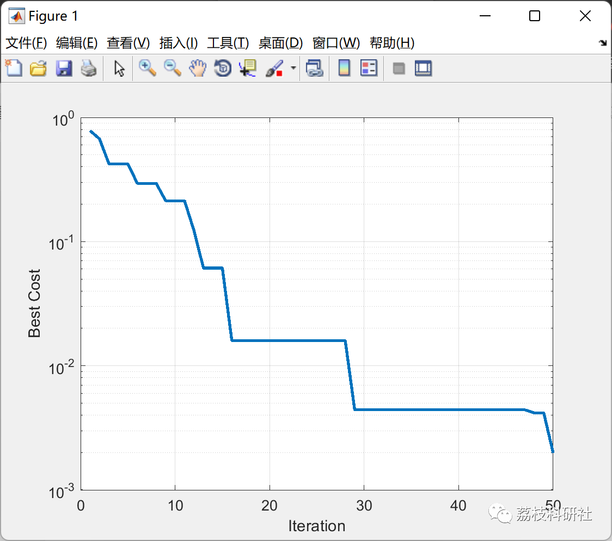

# Particle Swarm Optimization Applied to Neural Networks (Matlab Code Implementation)

💥💥💞💞 Welcome to this blog❤️❤️💥💥
🏆 Bloggers' Advantage: 🌞🌞🌞 The content of the blog strives for rigorous thinking and clear logic to facilitate readers.
⛳️ Mantra: Those who travel a hundred miles, make progress in ninety-nine steps.
Litchi Research Society
Code Collection: Power Systems, Intelligent Algorithms and Applications, Neural Network Prediction, Path Planning, Optimized Scheduling, Workshop Scheduling, Image Processing, Signal Processing...
🎁 Special Section Links:
🌈🌈🌈🌟🌟🌟🌟 Electrical Code Intelligent Algorithms and Their Applications Path Planning Neural Network Prediction Optimized Scheduling Image Processing Workshop Scheduling Signal Processing Romantic Her Thoughts My Philosophy Math Model Complete Code Issues
💥1 Overview
This article uses the PSO algorithm to update the weights and biases of the hidden layer and output layer.
📚2 Running Results
🎉3 References
[1] Selva (2022). Particle Swarm Optimized Neural Network.
🌈4 MATLAB Code Implementation
Click the article's lower left corner to [Read Full Content].

## Images

<!-- PAYMENT_BLOCK -->

## Get this dataset

- Payment link (Stripe): [Buy now](https://buy.stripe.com/3cs8yP7sY87d0vu9AB)
- Payment QR code: 

<!-- /PAYMENT_BLOCK -->
